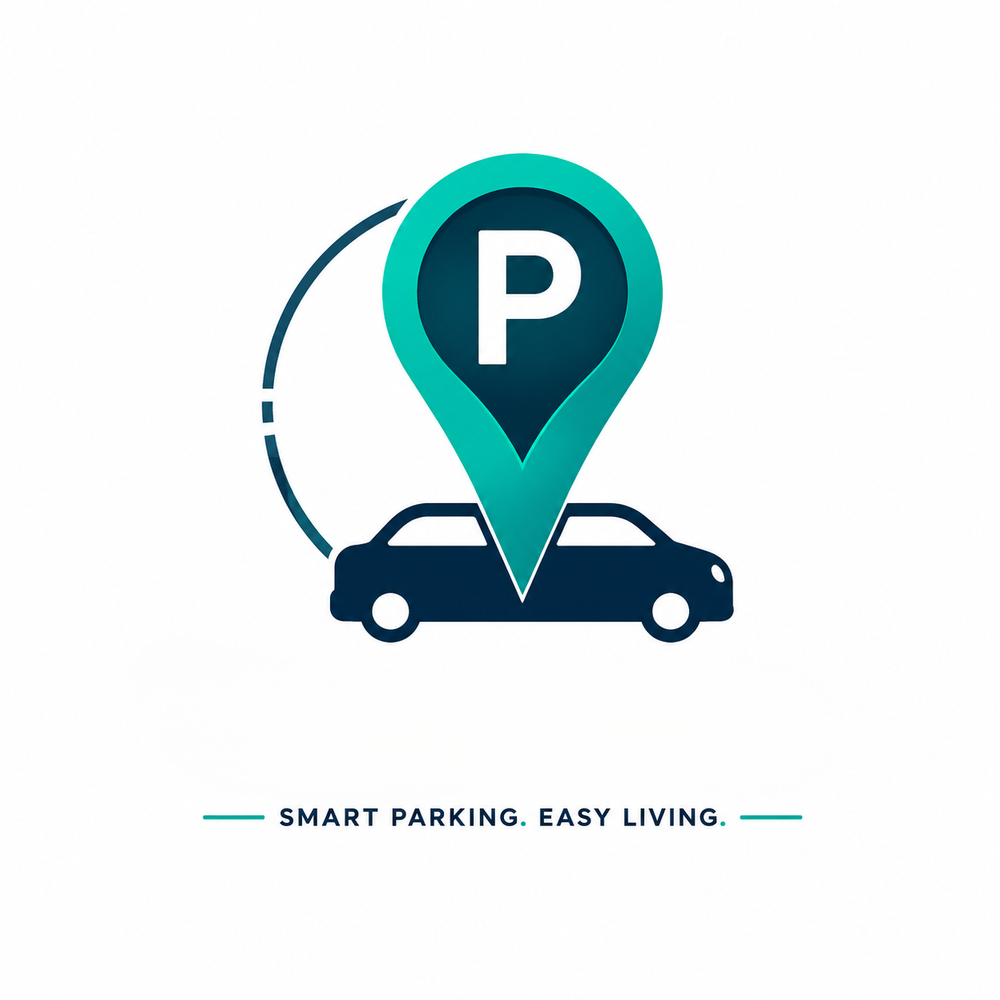
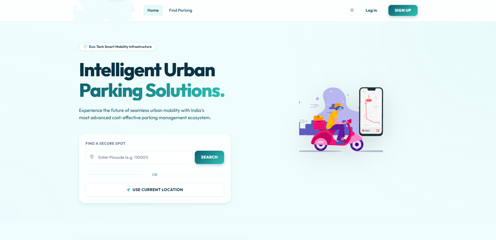
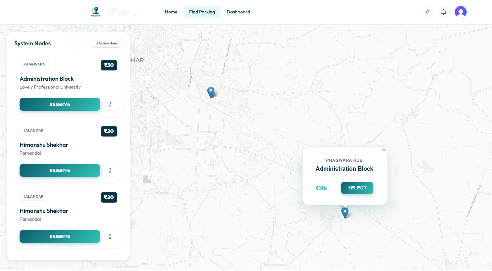
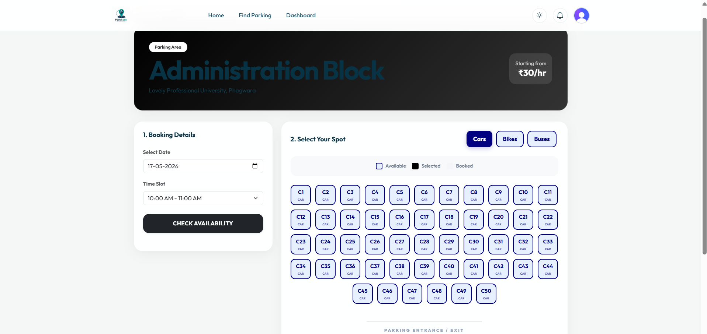
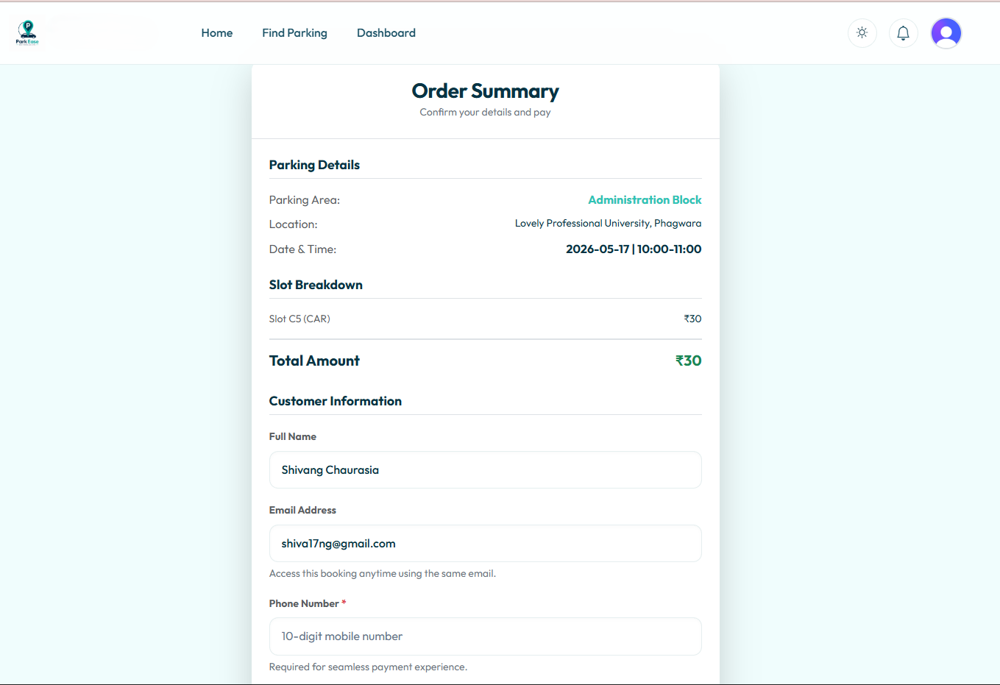
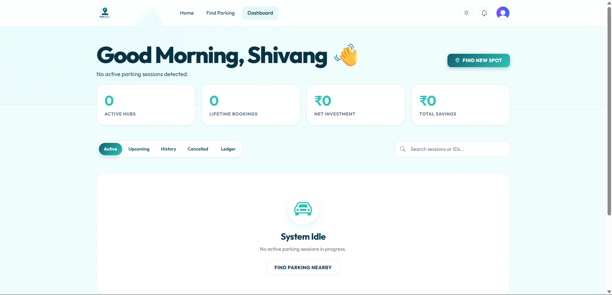
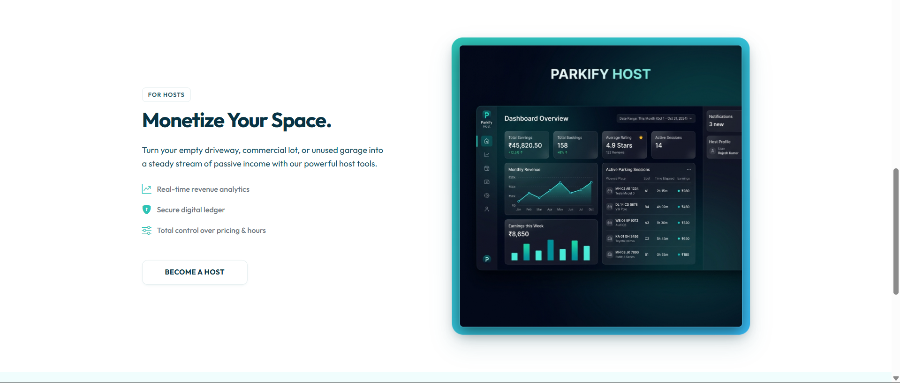
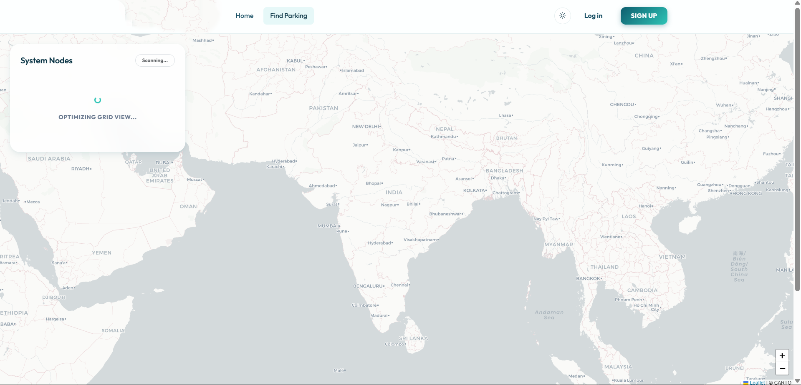
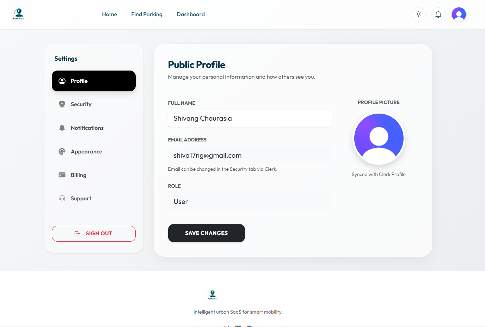

# SmartPark – Intelligent Urban Parking & Mobility Platform

<p align="center">
  
</p>

<p align="center">
  <b>A modern, full-stack smart mobility platform connecting drivers with parking hosts for seamless discovery, real-time visual slot reservations, automated gate verification, and facility revenue management.</b>
</p>

<p align="center">
  
  
  
  
  
  
</p>

---

## 🌟 Overview

Finding parking in congested commercial zones, universities, and IT corridors causes significant time loss, traffic gridlock, and fuel wastage. **SmartPark** solves this through a unified digital operating system that bridges motorists searching for verified parking with property owners looking to monetize unused parking inventory.

Built on **Python & Django**, SmartPark delivers end-to-end reservation integrity: collision-free slot allocation, real-time visual grid selection, dynamic Razorpay payments, automated cancellation refunds, and QR-coded digital gate passes.

---

## 📸 Application Interface & Visual Tour

### 1. Modern Urban Search & Landing Experience
Motorists can search for parking using PIN codes or instant browser-based GPS geolocation.
<p align="center">
  
</p>

---

### 2. Interactive Map-Based Parking Discovery
Browse parking facilities geographically with live pricing indicators, distance metrics, and one-click slot reservations.
<p align="center">
  
</p>

---

### 3. Real-Time Visual Slot Matrix & Vehicle Filtering
View the physical parking layout with occupancy indicators (Available, Selected, Booked) and switch seamlessly between Cars, Two-Wheelers, and Heavy Vehicles.
<p align="center">
  
</p>

---

### 4. Transparent Reservation Summary & Checkout
Review order breakdown, pricing, slot allocations, and customer contact info before securing spots via online payments or QR.
<p align="center">
  
</p>

---

### 5. Motorist Dashboard & Booking Management
Manage active, upcoming, past, and cancelled bookings. Extend active parking sessions in real time or trigger policy-based refunds.
<p align="center">
  
</p>

---

### 6. Parking Host Revenue Analytics & Property Portal
Hosts monitor 7-day revenue performance, manage slot capacities, schedule safe closures, and verify driver check-ins at entry gates.
<p align="center">
  
</p>

---

### 7. Nationwide Geospatial Infrastructure
Explore connected parking nodes across cities with dynamic clustering and interactive boundaries.
<p align="center">
  
</p>

---

### 8. User Account & Profile Settings
Comprehensive profile management with role switching between Driver and Host modes.
<p align="center">
  
</p>

---

## ⚡ Core Features

### 🚗 Motorist & Driver Module
- **Proximity Search:** Discovers parking within a configurable radius using the spherical Haversine formula or postal PIN code.
- **Collision-Proof Slot Engine:** Validates temporal availability:
  $$\text{NewStart} < \text{ExistingEnd} \quad\land\quad \text{NewEnd} > \text{ExistingStart}$$
- **Session Extension:** Allows drivers to extend active parking sessions on the fly, subject to downstream slot availability.
- **Automated Refund Engine:** Tiered refund policy calculated automatically:
  - $\ge 2\text{ hours}$ before arrival: **100% refund**
  - $30\text{ mins} - 2\text{ hours}$ before arrival: **50% refund**
  - $< 30\text{ mins}$ before arrival: **0% refund**
- **Digital QR Gate Tickets:** Generates downloadable ReportLab PDF tickets with embedded scannable verification tokens.

### 🏢 Parking Host / Owner Module
- **KYC Onboarding:** Identity verification workflow (Aadhaar, phone, and property photo uploads).
- **Automated Slot Grid Generation:** Automatic slot generation for Cars, Bikes, and Buses with customizable hourly pricing.
- **Safe Closure Protection:** Calculates dependent bookings and prevents facility removal until all active reservations expire.
- **Gate Check-in Scanner:** Validates 10-character booking codes to authenticate drivers and update entry status.
- **Revenue Dashboard:** Visualizes 7-day revenue analytics, daily earnings, and slot utilization trends with Chart.js.

### 🛡️ Administrative Portal
- **Centralized Platform Controls:** Complete administration of users, KYC requests, parking facilities, and transaction ledgers via Django Admin.

---

## 🛠️ Technology Stack

| Layer | Technologies |
| :--- | :--- |
| **Backend Framework** | Python 3.12+, Django 6.1+ |
| **Architecture** | Django MVT (Model-View-Template) with RESTful JSON endpoints |
| **Frontend UI** | HTML5, CSS3 (Glassmorphism design system), Bootstrap 5.3, JavaScript (ES6+) |
| **Interactive Maps** | Leaflet.js with Carto Light & OpenStreetMap tiles |
| **Data Visualization** | Chart.js for Host Revenue Analytics |
| **PDF & QR Generation** | ReportLab (Vector PDF tickets) + Python Qrcode |
| **Payment Gateway** | Razorpay API integration with HMAC-SHA256 signature verification |
| **Persistence Layer** | SQLite (Default / Development) • PostgreSQL-ready |
| **Authentication** | Django native session authentication, custom `User` model (`AbstractUser`) |

---

## 📁 Repository Structure

```
SmartPark-Django/
├── README.md                          # Repository Documentation & Architecture Guide
└── SmartPark-WebApp/                  # Core Django Web Application
    ├── manage.py                      # Django CLI Management Script
    ├── db.sqlite3                     # SQLite Database
    ├── requirements.txt               # Production Python Dependencies
    ├── Dockerfile                     # Container Deployment Configuration
    ├── .dockerignore                  # Docker Build Exclusions
    ├── .env.example                   # Environment Template
    │
    ├── smartpark/                     # Project Root Configuration
    │   ├── settings.py                # Django Settings & Global Parameters
    │   ├── urls.py                    # Root URL Routing Configuration
    │   ├── wsgi.py                    # WSGI Web Server Gateway
    │   └── asgi.py                    # ASGI Async Server Gateway
    │
    ├── accounts/                      # Authentication & Host KYC App
    │   ├── models.py                  # Custom User Model (Role, Phone, KYC status)
    │   ├── forms.py                   # Registration, Login, and KYC Forms
    │   ├── views.py                   # Auth Lifecycle & Role Switching Views
    │   └── urls.py                    # Account Routing
    │
    ├── parking/                       # Facility & Slot Management App
    │   ├── models.py                  # ParkingLot and Slot Models
    │   ├── forms.py                   # Property Listing & Slot Config Forms
    │   ├── views.py                   # Haversine Search, Slot API & Host Dashboard
    │   └── urls.py                    # Parking Routes & JSON APIs
    │
    ├── bookings/                      # Reservations, Payments & Tickets App
    │   ├── models.py                  # Booking and Transaction Ledgers
    │   ├── views.py                   # Checkout, Razorpay Verify & Cancel APIs
    │   ├── ticket_generator.py        # ReportLab PDF & QR Code Engine
    │   └── urls.py                    # Booking Routes & Webhook Endpoints
    │
    ├── core/                          # Shared Services & Management Commands
    │   ├── context_processors.py      # Global Theme & Notification Processor
    │   └── management/commands/
    │       └── seed_demo_data.py      # Demo Dataset Generator
    │
    ├── static/                        # Static Assets
    │   ├── css/
    │   │   ├── smartpark.css          # Glassmorphic Theme & Bootstrap Overrides
    │   │   └── parkease.css           # Design System Stylesheet
    │   ├── images/                    # Favicons, Branding, and Vector Badges
    │   └── Project_SS/                # High-Resolution UI Screenshots
    │
    └── templates/                     # Django Template Architecture
        ├── base.html                  # Master Glassmorphism Layout & Modals
        ├── welcome.html               # Landing Page & Geolocation Search
        ├── accounts/                  # Auth, Onboarding & Settings Templates
        ├── parking/                   # Search, Map, Details & Host Views
        └── bookings/                  # Checkout, Dashboard & Ticket Views
```

---

## 🚀 Quick Start & Installation

### Prerequisites
- Python 3.12 or newer installed on your machine.
- Git.

### 1. Clone the Repository
```bash
git clone https://github.com/ShivangChaurasia/SmartPark-Django.git
cd SmartPark-Django/SmartPark-WebApp
```

### 2. Set Up Virtual Environment
```bash
# Windows (PowerShell)
python -m venv venv
.\venv\Scripts\activate

# macOS / Linux
python3 -m venv venv
source venv/bin/activate
```

### 3. Install Dependencies
```bash
pip install -r requirements.txt
```

### 4. Initialize Database & Run Migrations
```bash
python manage.py makemigrations
python manage.py migrate
```

### 5. Seed Demo Data (Admin, Hosts, Drivers & Parking Lots)
```bash
python manage.py seed_demo_data
```

### 6. Start Development Server
```bash
python manage.py runserver
```
Visit **`http://127.0.0.1:8000/`** in your browser.

---

## 🔑 Pre-Seeded Demo Accounts

| Role | Username | Password | Capabilities |
| :--- | :--- | :--- | :--- |
| **Superuser / Admin** | `admin` | `admin123` | Full access to Django Admin at `/admin/` |
| **Parking Host** | `host_demo` | `host123` | Access Host Dashboard at `/owner/dashboard/`, manage facilities, verify gate entries |
| **Motorist / Driver** | `driver_demo` | `driver123` | Search, select slots, reserve, pay, download tickets, cancel/extend sessions |

---

## 🧪 Testing & Verification

Run the comprehensive unit test suite:
```bash
python manage.py test
```

Execute Django system integrity verification:
```bash
python manage.py check
```

---

## 🔒 Security & Best Practices

- **CSRF Protection:** Native Django CSRF tokens applied to all forms and AJAX/Fetch headers (`X-CSRFToken`).
- **Encrypted Passwords:** Passwords hashed with PBKDF2 with SHA256 iterations.
- **Race Condition Prevention:** Slot reservation validation handles double-booking edge cases through overlapping window checks and database transactions.
- **Payment Signature Verification:** HMAC-SHA256 signature verification guarantees order and payment integrity before booking confirmation.

---

## 📄 License

This project is licensed under the [MIT License](LICENSE).

